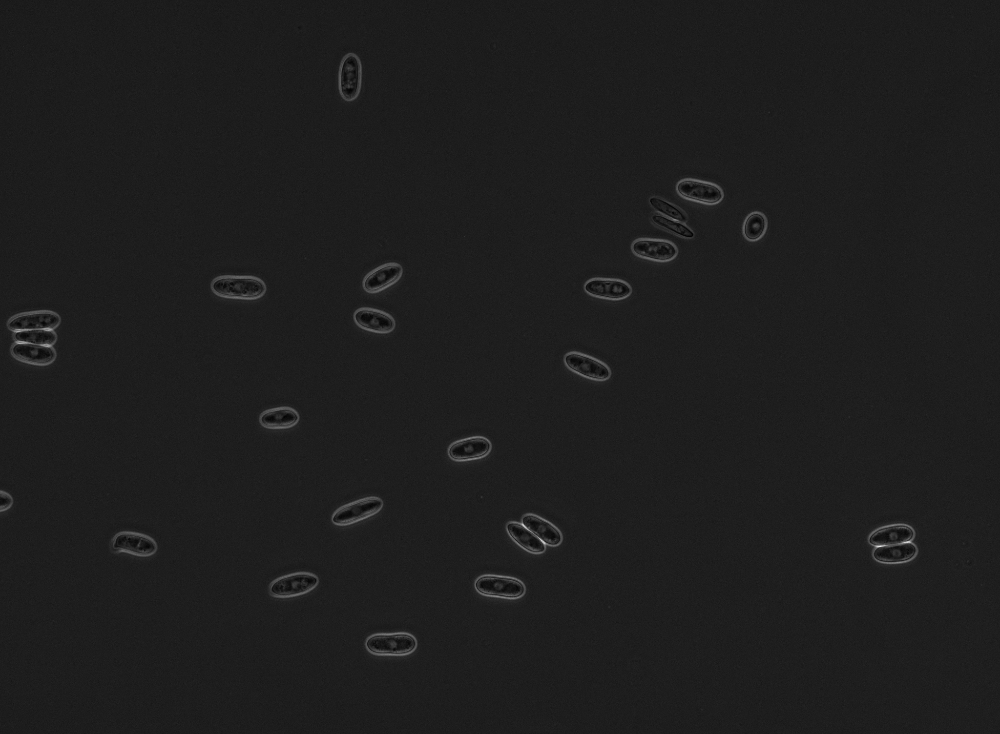

# microinterp

**Frame interpolation for microscopy time-series.** Synthesize plausible
in-between frames for a time-lapse, using four interchangeable models behind
one interface. Use it as a Python library, a command-line tool, or a small GUI.

Real frames pass through **unchanged** and the input data type is **preserved**
(16-bit TIFF in → 16-bit TIFF out); only the in-between frames are generated.

Developed at the Miranda Laboratory, North Carolina State University. This work
was funded by the National Institutes of Health NIH-NIGMS (R00GM135487 to
O.A.M.), the National Institute for Theory and Mathematics in Biology (NITMB),
NSF (DMS-2235451), the Simons Foundation (MPS-NITMB-00005320) and NSF
(DMS-2424748).


-27ae60)

<p align="center">
  
</p>

<sub>4× RIFE interpolation: the full output series, real frames and
synthesized in-betweens together.</sub>

## Motivation

- **Smoother visualization** of sparse or unevenly sampled time-lapses.
- **Denser temporal sampling**, which stabilizes downstream tracking and
  registration because smaller frame-to-frame motion is easier to link.
- **Less frequent imaging**, which reduces photobleaching and phototoxicity;
  the gaps are filled computationally.

## Ground truth vs. every backend

Each backend sees only every other real frame and reconstructs
the ones in between (the same check `microinterp compare` runs).
The GIFs play at 1 frame per second.

<p align="center"><b>Ground Truth</b><br>
</p>

<table>
<tr>
<td align="center" width="25%"><b>RIFE</b><br><br>PSNR 30.90 dB · SSIM 0.8293</td>
<td align="center" width="25%"><b>FILM</b><br><br>PSNR 30.25 dB · SSIM 0.7859</td>
<td align="center" width="25%"><b>CDFI</b><br><br>PSNR 30.26 dB · SSIM 0.7808</td>
<td align="center" width="25%"><b>LDMVFI</b><br><br>PSNR 30.61 dB · SSIM 0.7789</td>
</tr>
</table>

Mean PSNR/SSIM of the reconstructed frames on the bundled
5-frame sample.

| Backend | Type | Device | Notes |
|---|---|---|---|
| RIFE | optical flow (IFNet) | CPU or GPU | fast, general default; supports arbitrary timestep |
| FILM | feature pyramid + flow | GPU (CPU is slow) | strong on large motion |
| CDFI | AdaCoF kernels + GridNet | NVIDIA GPU | compact, sharp; fixed midpoint (t=0.5) |
| LDMVFI | latent diffusion (DDIM) | NVIDIA GPU | highest perceptual quality, slowest |

## Install

Requires Python 3.10 to 3.12.

```bash
pip install microinterp
microinterp setup
```

`microinterp setup` detects your hardware, asks for confirmation once
(`--yes` skips it) and installs what the models need:

- **NVIDIA GPU:** CUDA PyTorch, CuPy, the LDMVFI dependencies and engine, and
  the FILM, CDFI and LDMVFI weights.
- **No NVIDIA GPU:** the FILM weights only. RIFE and FILM run on the CPU.

Check the result with `microinterp list`.

### Manual GPU setup

Only needed if `microinterp setup` cannot be used, for example on an offline
machine or with a custom PyTorch build.

1. Install PyTorch with CUDA for your driver, then the CuPy build with the same
   CUDA major version (`cupy-cuda11x`, `cupy-cuda12x` or `cupy-cuda13x`, each
   `<14`) and, without a CUDA Toolkit, the matching headers (for example
   `nvidia-cuda-runtime-cu12==12.8.*` for torch CUDA 12.8), then
   `pip install "microinterp[gpu]"`.
2. Unpack the engine code, at the tested commits, into
   `~/.cache/microinterp/engine/` (or `$MICROINTERP_HOME/engine/`) as
   `LDMVFI/`, `taming-transformers/` and `CLIP/`:
   - [LDMVFI](https://codeload.github.com/danier97/LDMVFI/zip/eee2dc3566f21f22787d66b0f0337e48318403c6) (contains `ldm/` and `cupy_module/`)
   - [taming-transformers](https://codeload.github.com/CompVis/taming-transformers/zip/3ba01b241669f5ade541ce990f7650a3b8f65318) (contains `taming/`)
   - [CLIP](https://codeload.github.com/openai/CLIP/zip/d05afc436d78f1c48dc0dbf8e5980a9d471f35f6) (contains `clip/`)
3. The checkpoint downloads on first use (or with
   `microinterp download-weights --backend ldmvfi`). If Google Drive refuses the
   download, get it from [this link](https://drive.google.com/file/d/1_Xx2fBYQT9O-6O3zjzX76O9XduGnCh_7/view)
   and save it as
   `~/.cache/microinterp/weights/ldmvfi-vqflow-f32-c256-concat_max.ckpt`.

CDFI needs only step 1; its files download on first use (or with
`microinterp download-weights --backend cdfi`).

`microinterp list` names anything that is still missing.

## Run

```bash
microinterp compare demo
microinterp interpolate <frames_dir> --backend rife --factor 2 --out ./out
microinterp gui
```

On Linux the GUI needs `sudo apt install libxcb-cursor0` (Qt 6.5+).

`demo` is the bundled five-frame sample. `<frames_dir>` is a folder of
consecutive frames (`.tif/.png/.jpg/.bmp`), read in name order. `compare`
writes `comparison_overview.png` and `scores.json`.

**Python library:**

```python
import microinterp

intervals = [{"start": 0, "stop": len(stack) - 1, "interp": 1}]  # interp is log2 factor -> 2x
out, _ = microinterp.interpolate_intervals(stack, intervals, backend="rife")
layout = microinterp.describe_layout(len(stack), intervals)
#   layout[i] tells you whether output frame i is a real ('original') or synthesized frame
```

**GUI:** load a series, select a model, set the intervals and run. The result
window provides playback, side-by-side comparison and per-frame PSNR/SSIM.
**Validate** reconstructs held-out frames and scores them against the
originals.

CDFI and LDMVFI require an NVIDIA GPU. LDMVFI uses about 19 GB of memory for
2048 x 1504 frames; set `LDMVFI_DDIM_STEPS=50` instead of the default 200 for a
faster run.

## Configuration

No configuration file is needed; the defaults work as they are. To change a
setting, set an environment variable in the terminal before running microinterp:

```bash
export LDMVFI_DDIM_STEPS=50        # Linux and macOS
```

```powershell
$env:LDMVFI_DDIM_STEPS = "50"      # Windows PowerShell
```

A variable lasts for that terminal session only. To keep it, add the `export`
line to `~/.bashrc` (or `~/.zshrc`), or on Windows run `setx LDMVFI_DDIM_STEPS 50`
and open a new terminal. Available variables:

| Variable | Purpose |
|---|---|
| `MICROINTERP_HOME` | Folder for downloaded weights and the LDMVFI engine (default `~/.cache/microinterp`); use the same value for `microinterp setup` and every later run |
| `LDMVFI_DDIM_STEPS` | LDMVFI diffusion steps (default 200; 50 is much faster) |
| `LDMVFI_CKPT` | Use your own LDMVFI checkpoint |
| `CDFI_CKPT` | Use your own CDFI checkpoint |
| `FILM_WEIGHTS` | Use your own FILM weights file |
| `MICROINTERP_DEBUG` | Set to any value to show the full traceback when a command fails |

## Citing

If you use a backend, please cite the original method:

- **RIFE:** Huang, Z., Zhang, T., Heng, W., Shi, B., Zhou, S. Real-Time
  Intermediate Flow Estimation for Video Frame Interpolation. ECCV 2022.
- **FILM:** Reda, F., Kontkanen, J., Tabellion, E., Sun, D., Pantofaru, C.,
  Curless, B. FILM: Frame Interpolation for Large Motion. ECCV 2022.
- **CDFI:** Ding, T., Liang, L., Zhu, Z., Zharkov, I. CDFI: Compression-Driven
  Network Design for Frame Interpolation. CVPR 2021.
- **AdaCoF** (basis of CDFI): Lee, H., Kim, T., Chung, T., Pak, D., Ban, Y.,
  Lee, S. AdaCoF: Adaptive Collaboration of Flows for Video Frame
  Interpolation. CVPR 2020.
- **LDMVFI:** Danier, D., Zhang, F., Bull, D. LDMVFI: Video Frame Interpolation
  with Latent Diffusion Models. AAAI 2024.

## License

microinterp is released under the [MIT License](https://github.com/janampatel/Microscopy-Interpolations/blob/main/LICENSE). The models it wraps
(RIFE, FILM, CDFI, LDMVFI) and their weights keep their original licenses; see
[NOTICE.md](https://github.com/janampatel/Microscopy-Interpolations/blob/main/NOTICE.md). The GUI and pipeline are inspired by [filai](https://github.com/vatsal-dp/filogui3).
